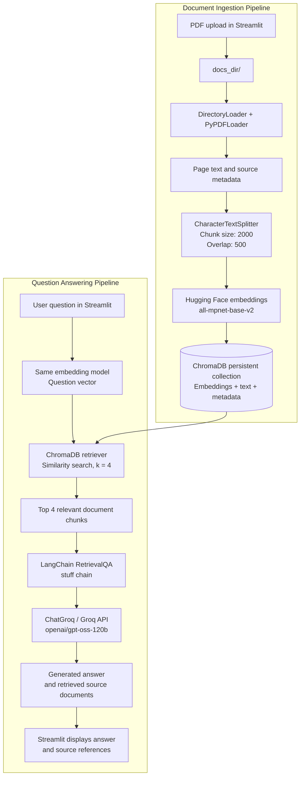

# DocMind — AI-Powered Document Intelligence

An intelligent PDF question-answering application built using Retrieval-Augmented Generation (RAG), LangChain, Streamlit, ChromaDB, Hugging Face and Groq.

DocMind allows users to upload PDF documents, process their contents and interact with them through a conversational AI interface. It retrieves relevant document information and uses a Large Language Model (LLM) to generate contextual answers with source references.

## Project Overview

Traditional chatbots rely primarily on the knowledge embedded in their language models. DocMind takes a document-grounded approach by retrieving relevant information from user-uploaded PDFs before generating answers.

The application implements a Retrieval-Augmented Generation (RAG) pipeline consisting of document ingestion, embedding generation, vector storage, semantic retrieval and LLM-based response generation.

## Key Features

- PDF document upload and processing.
- Automated text extraction from PDF documents.
- Text chunking for efficient retrieval.
- Semantic search using vector embeddings.
- Persistent vector storage with ChromaDB.
- Context-aware question answering using Groq-hosted LLMs.
- Source document references with page information.
- Interactive chatbot interface built with Streamlit.
- Multiple conversation sessions.

## Application Screenshots

### 1. DocMind Chatbot Interface


### 2. Document Question Answering


### 3. Retrieved Source References


## Technology Stack

| Component | Technology |
|---|---|
| Programming Language | Python |
| User Interface | Streamlit |
| LLM Orchestration | LangChain |
| PDF Processing | PyPDFLoader |
| Text Splitting | CharacterTextSplitter |
| Embedding Model | Hugging Face Sentence Transformers |
| Embedding Model Name | all-mpnet-base-v2 |
| Vector Database | ChromaDB |
| Language Model | openai/gpt-oss-120b |
| LLM Provider | Groq API |
| Environment Management | python-dotenv |

## System Architecture

DocMind consists of two main pipelines: document ingestion and question answering.

### Architecture Diagram

The diagram below shows how uploaded PDFs are processed and stored, and how a user's question retrieves relevant chunks before response generation.



### 1. Document Ingestion Pipeline

1. User uploads PDF documents.
2. PyPDFLoader extracts text page by page.
3. CharacterTextSplitter divides the extracted text into smaller chunks.
4. Hugging Face Sentence Transformers converts text chunks into vector embeddings.
5. ChromaDB stores the embeddings, document text and metadata.

### 2. Question Answering Pipeline

1. User submits a question through the Streamlit interface.
2. The embedding model converts the question into a vector.
3. ChromaDB performs similarity search.
4. The retriever selects the four most relevant chunks.
5. LangChain RetrievalQA combines the retrieved context.
6. The Groq-hosted LLM generates a response.
7. The application displays the answer and retrieved source information.

### RAG Workflow

PDF Upload → Text Extraction → Text Chunking → Embedding Generation → ChromaDB Storage → User Question → Similarity Search → Context Retrieval → LLM Generation → Answer with Sources

## Project Structure

```text
LangChain_RAG_UI/
│
├── app.py
├── requirements.txt
├── .env
├── .gitignore
│
├── docs/
│   ├── RAG_ARCHITECTURE.md
│   └── screenshots/
│       ├── 01-chatbot-interface.png
│       ├── 02-question-answering.png
│       └── 03-source-references.png
│
├── docs_dir/
│   └── Uploaded PDF documents
│
├── vector_db/
│   └── Persistent ChromaDB storage
│
└── src/
    ├── __init__.py
    ├── config.py
    ├── ingestion.py
    └── retrieval.py
```

Note: `.env`, uploaded PDFs and the local vector database are excluded from Git.

## Configuration

The application requires a Groq API key.

1. Obtain an API key from the Groq developer platform.
2. Create a `.env` file in the project root directory.
3. Add the following configuration:

```env
GROQ_API_KEY=your_groq_api_key
```

Do not commit your actual API key to GitHub.

## Installation and Setup

### Prerequisites

- Python 3.11
- Git
- Groq API key

### 1. Clone the repository

```bash
git clone https://github.com/ash-sheik/DocMind.git
cd DocMind
```

### 2. Create a virtual environment

```bash
python -m venv .venv
```

Activate it on Windows:

```powershell
.venv\Scripts\Activate.ps1
```

### 3. Install dependencies

```bash
pip install -r requirements.txt
```

### 4. Configure environment variables

Create a `.env` file in the project root and configure your Groq API key as described above.

### 5. Run the application

```bash
streamlit run app.py
```

Open the local URL displayed in the terminal.

## Model and Retrieval Configuration

| Parameter | Configuration |
|---|---|
| Embedding Model | sentence-transformers/all-mpnet-base-v2 |
| LLM | openai/gpt-oss-120b |
| Temperature | 0.0 |
| Chunk Size | 2000 |
| Chunk Overlap | 500 |
| Retrieval Strategy | Similarity Search |
| Retrieved Chunks | 4 |
| Vector Database | ChromaDB |

## Documentation

For a detailed explanation of the RAG architecture and workflow, refer to:

[RAG Architecture Documentation](docs/RAG_ARCHITECTURE.md)

## Future Enhancements

- Support for additional document formats.
- Improved document-level filtering.
- Enhanced retrieval strategies and relevance evaluation.
- Persistent conversation history.
- Document summarization.
- Improved error handling and user feedback.
- Evaluation of answer quality and retrieval accuracy.

## Author

**Ashiba B**

GitHub: https://github.com/ash-sheik

LinkedIn: https://www.linkedin.com/in/ashiba-data-analyst

---

*DocMind — Making document knowledge conversational.*
