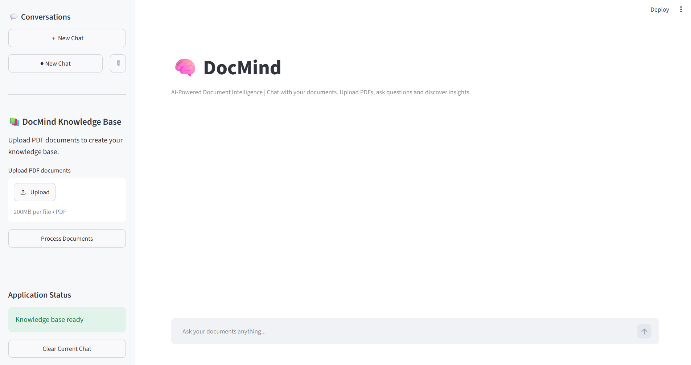
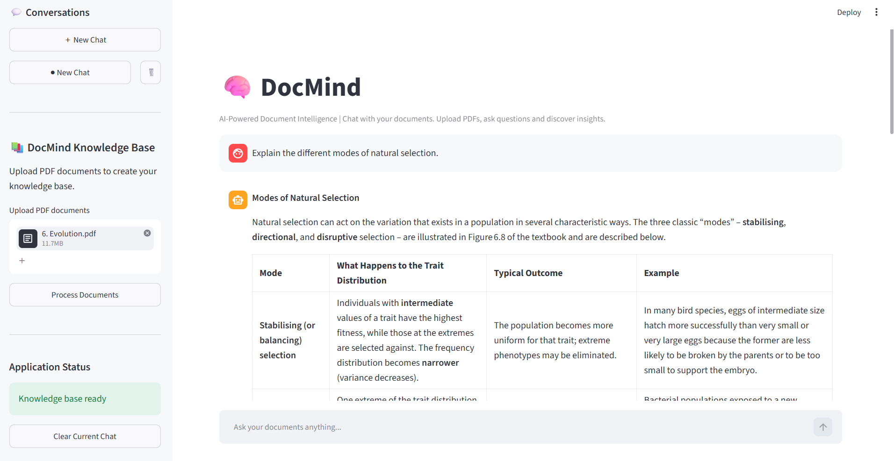
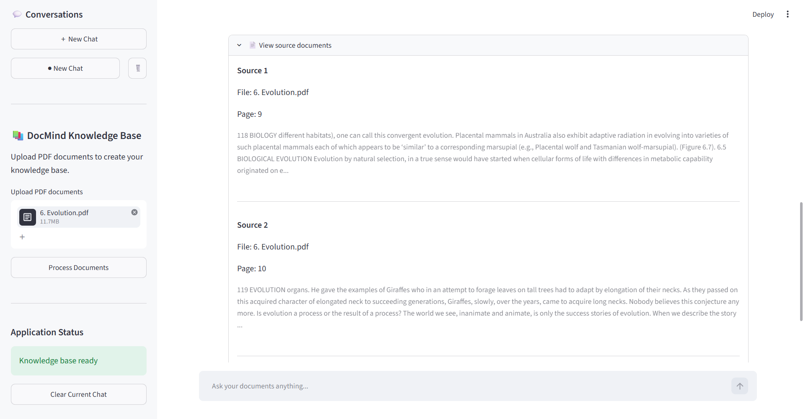
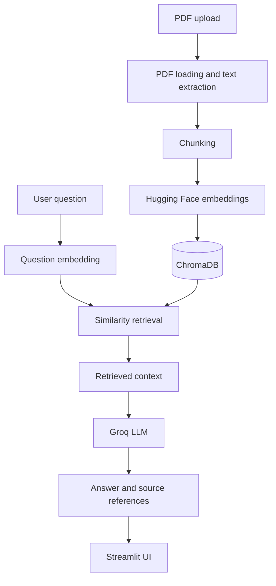

# DocMind — AI-Powered Document Intelligence

DocMind is a PDF question-answering application built with Python, Streamlit, LangChain, ChromaDB, Hugging Face embeddings and the Groq API. It uses a Retrieval-Augmented Generation (RAG) workflow to retrieve document passages and provide answers grounded in uploaded material.

## Problem and approach

Searching long PDFs manually is time-consuming. DocMind provides a conversational interface over uploaded documents:

1. Load PDF pages and retain source metadata.
2. Split extracted text into smaller chunks.
3. Generate embeddings with a Hugging Face sentence-transformer.
4. Store document chunks and vectors in ChromaDB.
5. Retrieve relevant chunks for a user's question.
6. Pass retrieved context to a Groq-hosted language model.
7. Display the generated response and source references.

## Features

- PDF document ingestion.
- Text extraction and chunking.
- Semantic retrieval using vector embeddings.
- Persistent ChromaDB vector storage.
- LLM-based question answering through Groq.
- Source-document metadata and page references.
- Streamlit chat interface.

## Screenshots







## Technology stack

| Component | Technology |
|---|---|
| Language | Python |
| UI | Streamlit |
| Orchestration | LangChain |
| PDF loading | PyPDFLoader |
| Text splitting | CharacterTextSplitter (current implementation) |
| Embeddings | Hugging Face Sentence Transformers |
| Embedding model | `sentence-transformers/all-mpnet-base-v2` |
| Vector store | ChromaDB |
| LLM provider | Groq |
| Config | python-dotenv |

## Architecture



## Repository structure

```text
DocMind/
├── app.py
├── requirements.txt
├── .gitignore
├── docs/
│   ├── RAG_ARCHITECTURE.md
│   └── screenshots/
├── src/
│   ├── config.py
│   ├── ingestion.py
│   └── retrieval.py
├── docs_dir/       # Local uploaded documents; not committed
└── vector_db/      # Local ChromaDB data; not committed
```

## Run locally

**Prerequisites:** Python 3.11 and a Groq API key.

1. Clone the repository:

   ```bash
   git clone https://github.com/ash-sheik/DocMind.git
   cd DocMind
   ```

2. Create and activate a virtual environment:

   ```bash
   python -m venv .venv
   ```

   Windows PowerShell:

   ```powershell
   .venv\Scripts\Activate.ps1
   ```

3. Install dependencies:

   ```bash
   pip install -r requirements.txt
   ```

4. Create a `.env` file in the project root:

   ```env
   GROQ_API_KEY=your_groq_api_key
   ```

5. Start the app:

   ```bash
   streamlit run app.py
   ```

Never commit API keys, private PDFs or local vector database files.

## Current configuration

| Setting | Value |
|---|---|
| Embedding model | `sentence-transformers/all-mpnet-base-v2` |
| LLM | `openai/gpt-oss-120b` via Groq |
| Temperature | 0.0 |
| Chunk size | 2000 |
| Chunk overlap | 500 |
| Retrieval | Similarity search |
| Retrieved chunks | 4 |

## Limitations and future work

This is a portfolio project and should be evaluated for retrieval quality and answer faithfulness before use with high-stakes documents. Useful next steps include automated ingestion/retrieval tests, document deduplication, upload limits, improved chunking, retrieval evaluation, stronger prompt safeguards and deployment.

## Author

**Ashiba B**

- [LinkedIn](https://www.linkedin.com/in/ashiba-data-analyst)
- [GitHub](https://github.com/ash-sheik)
